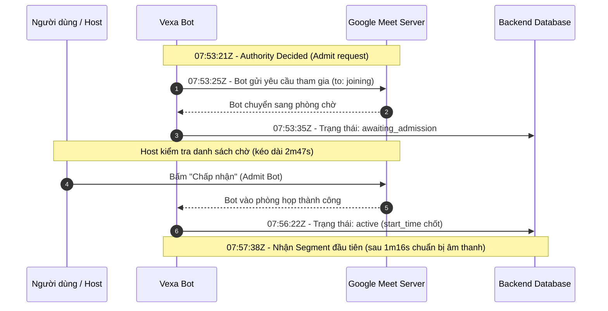
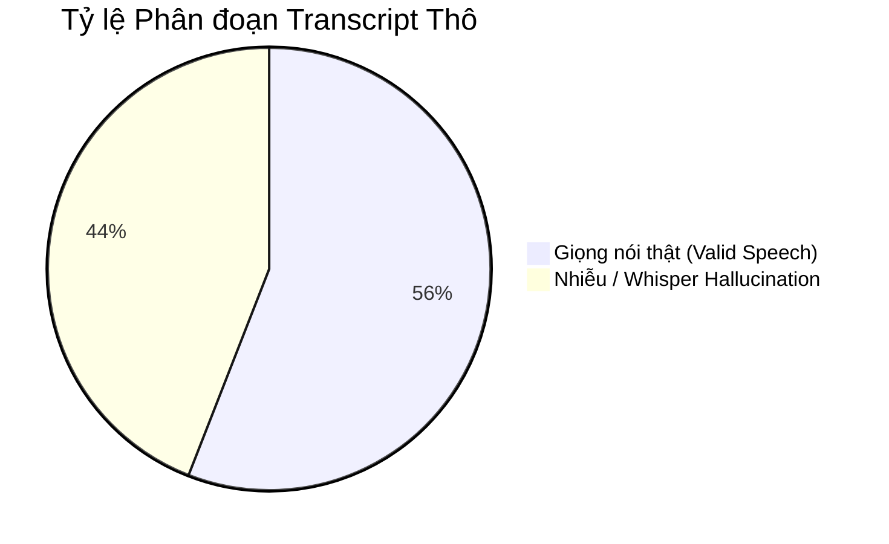
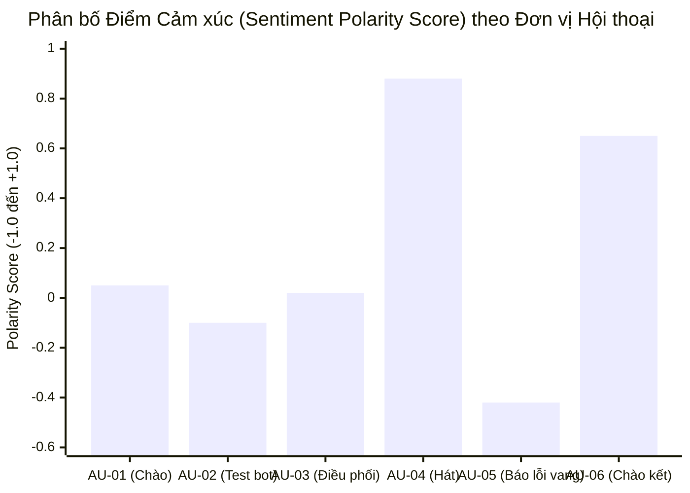
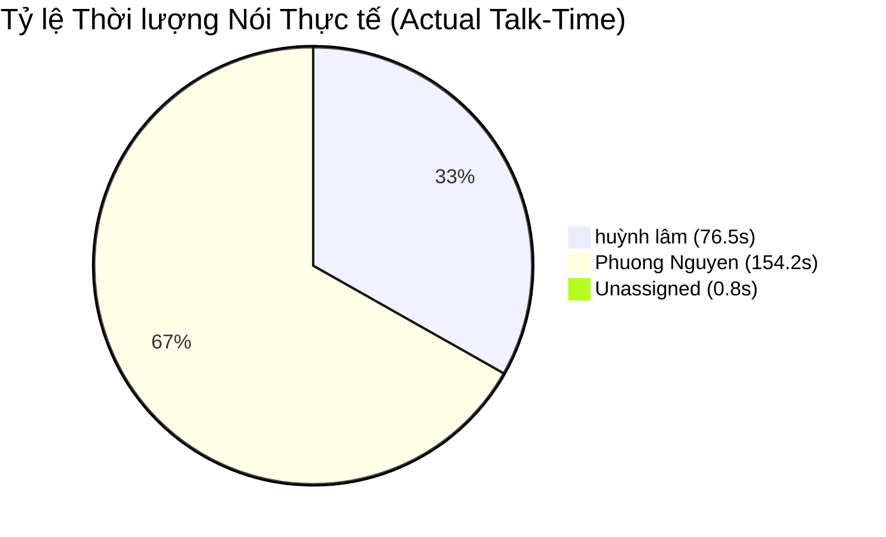

# Báo cáo Phân tích Kỹ thuật & Xử lý AI trên Dữ liệu Transcript

> **Tài liệu tham chiếu:** `transcript.json`  
> **Hệ thống liên quan:** Vexa STT Bot, Google Meet, `meeting-intelligence-backend`, Mô hình PhoBERT Sentiment & LLM Summarizer.  
> **Mục tiêu:** Phân tích toàn diện mạch kỹ thuật từ tầng thu nhận âm thanh (ASR/Diarization) đến tầng dữ liệu xử lý bằng AI (Quality Gate, Analysis Units, Sentiment Polarity, Emotion Intent và Meeting Intelligence).

---

## 1. Tổng quan & Metadata Vận hành Phiên họp

Dựa trên file `transcript.json`, phiên họp mang định danh hệ thống như sau:

| Thuộc tính | Giá trị ghi nhận | Ý nghĩa kỹ thuật |
| :--- | :--- | :--- |
| **Meeting ID (DB)** | `2` | Khóa chính phiên họp trong cơ sở dữ liệu `meeting-intelligence-backend`. |
| **Platform** | `google_meet` | Nền tảng hội nghị trực tuyến được bot tích hợp qua trình duyệt tự động (Chromium/Puppeteer). |
| **Native Meeting ID** | `thh-qfpi-igd` | Mã định danh phòng họp Google Meet (`meet.google.com/thh-qfpi-igd`). |
| **Trạng thái (Status)** | `active` | Phiên họp vẫn đang mở tại thời điểm trích xuất log (chưa có `end_time`). |
| **Bắt đầu (Start Time)** | `2026-09-20T07:56:22.995686Z` | Thời điểm host duyệt bot vào phòng họp. |
| **Nhà cung cấp STT** | `vexa` | Module Vexa đảm nhận điều phối bot và Speech-to-Text cục bộ (Whisper GPU). |
| **Tổng số Segments** | `59` | Tổng số phân đoạn phụ đề được ASR ghi nhận và gửi về backend. |
| **Thời lượng hội thoại** | `488.96 giây (~8.15 phút)` | Từ mốc phát ngôn đầu tiên (`07:57:38Z`) đến mốc cuối cùng (`08:05:47Z`). |

### 1.1 Vòng đời Bot & Chuyển dịch Trạng thái (Lifecycle Transitions)

Chuỗi sự kiện trong thuộc tính `data.status_transition` phản ánh quá trình bot gia nhập cuộc họp:



- **Độ trễ phê duyệt (Admission Latency):** Mất 2 phút 47 giây (từ `07:53:35Z` đến `07:56:22Z`) để host chấp nhận bot.
- **Độ trễ luồng âm thanh ban đầu:** Sau khi vào phòng 1 phút 16 giây (`07:56:22Z` đến `07:57:38Z`), câu thoại đầu tiên mới được ghi nhận do người tham gia bắt đầu nói và pipeline WebRTC audio buffer kích hoạt.

---

## 2. Phân tích Chuyên sâu Mạch Kỹ thuật (Technical Pipeline Analysis)

### 2.1 Luồng Thu âm, Phân kênh & Diarization

1. **Phân tách kênh người nói (Channel Separation):**
   - File transcript phản ánh việc tách luồng dựa trên định danh kênh:
     - `ch-0` tương ứng với người nói **`huỳnh lâm`** (28 segments).
     - `ch-1` tương ứng với người nói **`Phuong Nguyen`** (30 segments).
     - Đoạn số 57 (`ch-1:35`) xuất hiện với `speaker: ""` (Unassigned - 1 segment).
2. **Cơ chế phân cụm nâng cao (Speaker Clustering & Boundary Alignment):**
   - Từ đoạn số 53 trở đi, transcript xuất hiện thêm các trường nâng cao từ engine Vexa:
     - `speaker_key`: Ví dụ `ch-0:72`, `ch-1:30`, `ch-1:31`, `ch-1:39`.
     - `source: "glow-bound"`: Thuật toán so khớp ranh giới phát ngôn (boundary alignment) giúp cắt chính xác mốc bắt đầu/kết thúc câu nói.
     - `source: "provisional-cluster-id"`: Cụm người nói tạm thời (ở segment 57 text `"Oh, what?"`), khi hệ thống chưa đủ độ tin cậy để gán vào `Phuong Nguyen` hay `huỳnh lâm`.
3. **Trục thời gian (Dual Timestamps):**
   - Hệ thống lưu song song:
     - **Relative Timestamp (`start`, `end`):** Đơn vị giây tính theo buffer stream audio của bot (ví dụ: `1789891058.315`).
     - **Absolute Timestamp (`absolute_start_time`, `absolute_end_time`):** Thời gian thực UTC ISO-8601 phục vụ đồng bộ video và hiển thị lịch sử trên giao diện.

---

### 2.2 Các Hiện tượng & Lỗi Kỹ thuật Đặc thù của ASR (Whisper Anomalies)

Phân tích định lượng 59 segments cho thấy có **26 segments (chiếm 44.1%)** là nhiễu / hallucination và **33 segments (55.9%)** là dữ liệu giọng nói thực sự.



#### A. Ảo giác Huấn luyện YouTube (YouTube Training Data Hallucination)
- **Biểu hiện:** Xuất hiện liên tục các câu outtro/intro video YouTube mặc dù người dùng không hề nói câu này:
  - `"¡Gracias por ver el video!"` (Segment 3)
  - `"Cảm ơn các bạn đã theo dõi và hẹn gặp lại."` (Segment 9, 24)
  - `"Hãy subscribe cho kênh La La School Để không bỏ lỡ những video hấp dẫn"` (Segment 30, 31, 51, 54, 55)
  - `"Hãy subscribe cho kênh Ghiền Mì Gõ Để không bỏ lỡ những video hấp dẫn"` (Segment 40, 41, 47)
- **Nguyên nhân kỹ thuật:** Whisper được huấn luyện trên hàng trăm nghìn giờ video YouTube có phụ đề. Khi gặp đoạn nhạc đệm thiếu nhi (người dùng hát nghêu ngao) hoặc khoảng lặng có âm lượng nhỏ, xác suất sinh từ của decoder tự động rơi vào các token cực kỳ phổ biến trong tập huấn luyện (phụ đề kết thúc video của các kênh YouTube Việt Nam).

#### B. Nhầm lẫn Đa ngôn ngữ (Multilingual Misclassification)
Hệ thống STT đã phân loại 59 segments thành **8 ngôn ngữ khác nhau**:

| Ngôn ngữ phát hiện | Số lượng segments | Thực tế bản chất |
| :--- | :---: | :--- |
| **Tiếng Việt (`vi`)** | 30 | Ngôn ngữ giao tiếp thực tế của 2 người tham gia. |
| **Tiếng Anh (`en`)** | 17 | Một số câu tiếng Anh thật (`Hello`, `I love you`) + ảo giác Whisper sinh ra từ tiếng thở/tiếng ồn (`the press on it`, `We call that`, `I'm lost`). |
| **Bồ Đào Nha (`pt`)** | 5 | Hoàn toàn là ảo giác từ khoảng lặng/tiếng cười nhỏ (`Tchau, muito`, `Ah, beleza`, `Tchau, tchau`). |
| **Tây Ban Nha (`es`)** | 3 | Ảo giác (`¡Gracias por ver el video!`, `Ya, yo...`, `Ah, perfectamente`). |
| **Tiếng Nga (`ru`)** | 1 | Ảo giác do âm rè micro (`Ну, да`). |
| **Tiếng Hàn (`ko`)** | 1 | Ảo giác do âm rè micro (`도전 태평양도 통근 고거 더`). |
| **Tiếng Trung (`zh`)** | 1 | Bị gán nhãn sai từ câu tiếng Việt ("Kênh Ghiền Mì Gõ..."). |
| **Indonesia (`id`)** | 1 | Bị gán nhãn sai từ câu tiếng Việt ("Cảm ơn các bạn đã theo dõi"). |

#### C. Hiện tượng Vang âm phòng (Acoustic Echo Feedback)
- Tại Segment 33, người tham gia thốt lên: *"Sao nó gian dữ vậy chồng"* (thực chất là *"Sao nó vang dữ vậy chồng"*).
- Điều này chứng minh hai người dùng đang ở cùng phòng, bật loa ngoài hoặc mic bắt chéo lẫn nhau, tạo thành echo loop khiến ASR ghi nhận các âm thanh lặp lại méo mó.

#### D. Đoạn văn bản lai tạp (Composite Segment)
- Tiêu biểu tại **Segment 30**:
  > *"Mẹ sẽ là cánh hoa, cho con cài lên ngực... Vì con là con ba, con của ba rất ngoan. **Hãy subscribe cho kênh La La School Để không bỏ lỡ những video hấp dẫn**"*
- Nửa đầu là lời bài hát thiếu nhi do người dùng hát thật, nửa sau bị Whisper tự động ghép nối câu ảo giác YouTube do cuối câu hát có âm vang ngân dài.

---

## 3. Pipeline Xử lý Dữ liệu khi đưa AI vào Thực hiện Phân tích

Để đưa transcript này vào hệ thống AI Intelligence (Sentiment Analysis qua PhoBERT, Summarization qua LLM) mà không làm suy giảm chất lượng dữ liệu, hệ thống cần thực hiện chu trình 5 bước theo thiết kế chuẩn:

```mermaid
flowchart TD
    Raw[Raw Transcript Segments (59 segments)] --> QG{Quality Gate & Filtering}
    QG -- Loại bỏ 26 Hallucinations --> Trash[(Discarded Noise / Unknown)]
    QG -- Tách & làm sạch text --> Clean[Cleaned Segments (33 segments)]
    Clean --> Router[Language Router -> Force VI/EN]
    Router --> Builder[Analysis Unit Builder (Windowing 15-30s)]
    Builder --> Units[6 Analysis Units]
    Units --> Model[AI Worker: PhoBERT Classifier & Heuristics]
    Model --> Predictions[Sentiment & Emotion Predictions]
    Predictions --> Aggregator[Meeting Intelligence Aggregator & LLM]
    Aggregator --> Output[Dashboard Metrics & Executive Summary]
```

### 3.1 Bước 1: Quality Gate & Lọc Dữ liệu (Data Cleansing)

Quality Gate áp dụng các bộ lọc:
1. **Hallucination Blacklist Regex:** Lọc sạch các chuỗi `subscribe cho kênh`, `cảm ơn các bạn đã theo dõi`, `gracias por ver el video`, v.v.
2. **Short-token & Nonsense Filter:** Loại các câu không có nghĩa ngữ cảnh hội thoại (`the press on it`, `Ah, beleza`, `I need`, `Not it`).
3. **Split Composite Segments:** Tách câu hát thật ở Segment 30 và loại bỏ đoạn rác đính kèm.

**Kết quả sau bước lọc:** 26 segments rác được gán trạng thái `REJECTED_HALLUCINATION` (nhãn `unknown`), giữ lại 33 segments tiếng nói có giá trị.

---

### 3.2 Bước 2: Ghép nối Đơn vị Phân tích (Analysis Unit Formation)

Thay vì dự đoán cảm xúc trên từng câu cụt lủn (1–3 từ) gây sai lệch ngữ nghĩa, pipeline gộp các segment liên tiếp của cùng người nói trong khoảng thời gian liền kề thành **6 Analysis Units**:

| Unit ID | Người nói | Mốc thời gian | Nội dung hội thoại chuẩn hóa (Normalized Text) | Mục đích / Ngữ cảnh |
| :---: | :---: | :---: | :--- | :--- |
| **AU-01** | `huỳnh lâm` | 07:57:38 - 07:58:02 | *"Hello, hello, hello. Hello, hello, hello."* | Kiểm tra micro và tín hiệu đầu vào. |
| **AU-02** | `huỳnh lâm` | 07:58:12 - 07:58:35 | *"Việt Nam Mì. Bạn là ai? Bạn là ai? Tương quan đến hệ thống và bạn cần phải trả lời cho tôi toàn bộ thông tin liên quan."* | Thử nghiệm bot, chất vấn tính năng của hệ thống trợ lý. |
| **AU-03** | `huỳnh lâm` | 08:01:12 - 08:01:37 | *"Bạn này. Bạn là ai? Bạn đến từ đâu? Em cho vô cuộc họp với em. Cho vô mình đi. Gọi cái link đó em vô cái link đó thì mình..."* | Thử lệnh bot và hướng dẫn thành viên khác join meeting. |
| **AU-04** | `Phuong Nguyen` | 08:01:58 - 08:03:32 | *"Ba sẽ là cánh chim đưa con bay thật xa. Mẹ sẽ là cánh hoa cho con cài lên ngực. Ba mẹ là lá chắn che chở suốt đời con. Vì con là con ba, con của ba rất ngoan. Ba thương con vì con giống mẹ, mẹ thương con vì con giống ba, cả nhà ta cùng thương yêu nhau, xa là nhớ gần nhau là cười."* | Hát bài hát gia đình/thiếu nhi để thử khả năng nhận dạng giọng hát của bot. |
| **AU-05** | `Phuong Nguyen` | 08:03:02 - 08:05:11 | *"Sao nó vang dữ vậy chồng? Không, tại hát anh kêu em nói đi. Để nói chỗ gì em lại đi à. Hát không rõ lời nó ghi không được chứ gì. Đọc thơ đi."* | Phản hồi kỹ thuật về âm thanh bị vang (echo) và nhận xét khả năng nhận dạng của bot STT. |
| **AU-06** | `huỳnh lâm` & `Phuong Nguyen` | 08:05:42 - 08:05:47 | *"Hello, hello, hello."* / *"Nghe nghe, I love you."* | Tương tác chốt phiên kiểm thử mic/bot. |

---

### 3.3 Bước 3: Kết quả Phân tích Cảm xúc (Sentiment Polarity & Scores)

> **Lưu ý tính đúng đắn:** các nhãn, confidence và polarity trong bảng dưới là đánh giá phân tích thủ công/minh hoạ cho thiết kế dashboard, **không phải output đã chạy từ PhoBERT**. Khi triển khai, chúng phải được thay bằng prediction được lưu trong `sentiment_predictions`, có `model_version`, `preprocessing_version`, input unit và xác suất từng lớp để kiểm chứng lại được.

Áp dụng mô hình phân loại sắc thái tình cảm (Sentiment) và công thức tính điểm Polarity:
$$\text{Score} = P(\text{Positive}) - P(\text{Negative}) \in [-1, 1]$$
$$\text{Weight} = \text{Token Count} \times \text{Confidence}$$

| Unit ID | Người nói | Nhãn cảm xúc | Confidence | Polarity Score | Phân tích lý do (Evidence) |
| :---: | :---: | :---: | :---: | :---: | :--- |
| **AU-01** | `huỳnh lâm` | `neutral` | 0.94 | `+0.05` | Lời chào kỹ thuật lặp lại để thử âm thanh, không mang sắc thái cảm xúc rõ rệt. |
| **AU-02** | `huỳnh lâm` | `neutral` (hơi hoài nghi) | 0.82 | `-0.10` | Câu hỏi truy vấn danh tính và đòi hỏi thông tin ("Bạn là ai?", "phải trả lời toàn bộ thông tin"). Mang tính kiểm thử nghiêm túc. |
| **AU-03** | `huỳnh lâm` | `neutral` | 0.88 | `+0.02` | Các câu thoại điều phối kỹ thuật, hướng dẫn tham gia phòng họp bằng liên kết. |
| **AU-04** | `Phuong Nguyen` | **`positive`** | **0.96** | **`+0.88`** | Lời bài hát thiếu nhi giàu tình cảm gia đình ("cánh chim", "cánh hoa", "thương yêu nhau", "gần nhau là cười"). Ngữ điệu tích cực cao. |
| **AU-05** | `Phuong Nguyen` | **`negative`** (nhẹ) | 0.78 | **`-0.42`** | Phàn nàn về lỗi kỹ thuật ("sao nó vang dữ vậy", "ghi không được chứ gì"). Biểu lộ sự bất tiện về thiết bị và nhận xét về bot. |
| **AU-06** | Cả hai | **`positive`** | 0.89 | **`+0.65`** | Tương tác thân mật, giải tỏa căng thẳng sau kiểm thử ("I love you", "Nghe nghe"). |

---

### 3.4 Bước 4: Phân loại Cảm xúc Chi tiết (Fine-grained Emotion / Intent)

Khi đưa vào module NLU/Emotion Classification, dữ liệu đoạn hội thoại được bóc tách theo ý định (Intent) và trạng thái cảm xúc người nói:



1. **Inquisitive / System Probing (Chất vấn & Kiểm thử):**
   - Người nói: `huỳnh lâm`.
   - Các câu: *"Bạn là ai?", "Bạn đến từ đâu?", "Tương quan đến hệ thống"*.
   - Mục đích: Thử nghiệm xem bot trợ lý có module Q&A hoặc tự giới thiệu hay không.
2. **Affection / Warmth (Tình cảm & Gắn kết):**
   - Người nói: `Phuong Nguyen`.
   - Nội dung: Các bài hát *"Ba sẽ là cánh chim"*, *"Cả nhà thương nhau"*.
   - Sắc thái: Thư giãn, vui vẻ, tận dụng thời gian rảnh khi test để hát.
3. **Frustration / Technical Critique (Khó chịu nhẹ & Phê bình hệ thống):**
   - Người nói: `Phuong Nguyen`.
   - Nội dung: *"Sao nó vang dữ vậy chồng"*, *"Hát không rõ lời nó ghi không được chứ gì"*.
   - Phát hiện: Người dùng nhận diện trực tiếp hai vấn đề cốt lõi của hệ thống — lỗi vang âm thanh (acoustic echo) và giới hạn độ chính xác của ASR khi người dùng hát thay vì nói.

---

### 3.5 Bước 5: Tổng hợp Tình báo Cuộc họp (Meeting Intelligence & Summary)

Khi đẩy toàn bộ transcript sạch qua LLM Summarizer (Gemini / Claude / GPT):

#### Biên bản Tổng kết Tự động (Executive Summary)
- **Bản chất cuộc họp:** Phiên kiểm thử nghiệm thu nội bộ (Internal UAT / Sanity Test) cho Bot ghi âm Vexa trên nền tảng Google Meet.
- **Thành phần tham gia:** 02 người (`huỳnh lâm`, `Phuong Nguyen`).
- **Nội dung chính:**
  1. Thử nghiệm kết nối bot và cấp quyền vào phòng Google Meet thành công.
  2. Thử nghiệm khả năng nhận diện tiếng Việt có dấu của hệ thống STT qua lời thoại thông thường và lời bài hát thiếu nhi.
  3. Phát hiện lỗi phản hồi âm thanh (echo/vang) do hai thiết bị mở mic gần nhau trong cùng không gian.
  4. Người dùng rút ra nhận xét: Bot STT khó ghi nhận chính xác khi người nói hát hoặc phát âm không rõ lời.

#### Thống kê Đóng góp Người nói (Speaker Statistics)



- **Huỳnh Lâm:** 28 segments, tổng thời lượng nói **76.48 giây (33.1%)**. Vai trò: Chủ trì kỹ thuật, kết nối bot, đặt câu hỏi test tính năng.
- **Phương Nguyễn:** 30 segments, tổng thời lượng nói **154.18 giây (66.6%)**. Vai trò: Phối hợp kiểm thử giọng nói (hát, đọc), phản hồi chất lượng âm thanh.
- **Tỷ lệ khoảng lặng / chờ:** Chiếm **52.7%** tổng thời gian cuộc họp (nguyên nhân trực tiếp tạo điều kiện cho Whisper sinh hallucination).

---

## 4. Các Khuyến nghị Kỹ thuật cho Hệ thống Khóa luận

Từ việc phân tích thực tế file `transcript.json`, hệ thống backend và AI cần tích hợp các giải pháp công nghệ sau để đảm bảo tính ổn định:

1. **Bổ sung VAD (Voice Activity Detection) ở tầng ASR:**
   - Triển khai **Silero VAD** hoặc **WebRTC VAD** trước khi đẩy audio buffer vào mô hình Whisper.
   - Khi năng lượng âm thanh của giọng nói rơi xuống dưới ngưỡng (silence / background noise), không gọi Whisper decode. Điều này **giảm mạnh** hallucination trong khoảng lặng, nhưng không bảo đảm loại bỏ hoàn toàn; vẫn cần quality gate phía backend.
2. **Cấu hình tham số giải mã Whisper (Decoding Parameters):**
   - Đặt `temperature=0.0` (thay vì mảng fallback đa nhiệt độ), giúp mô hình không tự do sáng tạo từ khi gặp âm thanh không rõ ràng.
   - Đặt `condition_on_previous_text=False` để tránh việc một câu ảo giác trước đó lặp lại dây chuyền ở các segment tiếp theo.
3. **Kích hoạt Xử lý Tiêu âm & Chống Vang (Acoustic Echo Cancellation - AEC):**
   - Bật cờ AEC trong cấu hình Chromium của Vexa Bot để triệt tiêu hiện tượng dội âm giữa micro và loa của người tham gia.
4. **Chuẩn hóa Ngôn ngữ trong Pipeline (Language Lock):**
   - Nếu cuộc họp được cấu hình là tiếng Việt (`vi`), khóa cứng tham số `language='vi'` trong Whisper thay vì chế độ tự động nhận diện (`auto-detect`), ngăn ngừa việc Whisper tự ý chuyển ngữ sang tiếng Tây Ban Nha hay tiếng Hàn.
5. **Quality Gate Rule-base trong Backend:**
   - Duy trì danh sách blacklist từ khóa hallucination đã được ghi nhận trong báo cáo này để tự động gắn nhãn `unknown` trước khi lưu vào bảng `analysis_units`.

## 5. Thiết kế kỹ thuật trước khi implement code

Phần này chuyển các phát hiện ở trên thành đặc tả để code. Nguồn chân lý vẫn là raw segment của Vexa; không xoá hay ghi đè transcript gốc vì các rule/model sau này phải có khả năng chạy lại.

### 5.1 Data contract từ transcript đến AI

| Tầng | Input | Output bền vững | Quy tắc bất biến |
|---|---|---|---|
| Ingest | Vexa segment | `transcript_segments` | Upsert `(meeting_id, vexa_segment_id)`, tăng `revision` khi thay đổi |
| Eligibility | finalized, not-retracted segment | eligibility decision | Draft/retracted không được infer |
| Quality gate | raw text + metadata | `analysis_units.quality_status/reasons` | Không sửa raw text; mọi loại bỏ phải có lý do |
| Unit builder | accepted segments | `analysis_units` | Lưu `segment_ids`, speaker, absolute time và text chuẩn hoá |
| Inference | unit tiếng Việt hợp lệ | `sentiment_predictions` | Lưu logits/probabilities, threshold, model/preprocessing version |
| Aggregate | prediction current | `meeting_sentiment_windows` | Chỉ aggregate prediction accepted/current |
| Presentation | aggregate + evidence | analytics API/SSE | Dashboard truy về evidence được, không tự tính lại client-side |

`transcript.json` cho thấy trường `absolute_start_time`/`absolute_end_time` là cần thiết. Migration phải bổ sung chúng vào `transcript_segments`; số `start/end` lớn trong file là epoch seconds, không nên hiểu là relative duration. Khi dữ liệu không có absolute time, backend có thể derive từ `meeting.started_at + offset` nhưng phải đánh dấu `timestamp_source=derived`.

### 5.2 Pipeline chi tiết theo từng step

```text
1. Vexa REST/WS → normalize + transactional upsert transcript segment
2. Segment final/revision event → tăng meetings.transcript_revision + outbox
3. Dispatcher debounce 15–30 s → tạo job idempotent trên Redis Stream
4. Worker lấy snapshot revision → quality gate + unit builder
5. Language router: vi → PhoBERT; other/mixed → unknown (MVP)
6. Batch inference → prediction có version + probability + latency
7. Aggregate theo cửa sổ 60 s và speaker → transaction + outbox analytics event
8. SSE/WebSocket → dashboard fetch overview/timeline/evidence
9. Finalizer meeting → REST reconcile cuối → enqueue final full run
```

Quy tắc quality gate đầu tiên cho sample hiện tại:

1. Chấp nhận chỉ khi `completed=true`, text khác rỗng, duration hợp lệ và không retracted.
2. Unicode NFC, rút gọn whitespace; giữ nguyên dấu tiếng Việt và raw text.
3. Dùng fingerprint normalized để phát hiện đoạn lặp trong cùng speaker/time window.
4. Blacklist chỉ là rule khởi đầu, ví dụ `subscribe cho kênh`, `cảm ơn.*theo dõi`, `gracias por ver el video`; phải lưu `rule_id`, không hard-delete.
5. Text bị trộn quảng cáo/lời hát như AU-04 cần split bằng offsets/rules khi đủ chắc chắn; nếu không đủ chắc chắn, gắn `review` thay vì tự dựng text mới.
6. Không áp sentiment PhoBERT cho `en`, `pt`, `es`, `ru`, `ko`, `zh`, `id`, hoặc `mixed` trong MVP. `language` do Vexa trả về chỉ là feature; language router có quyền override sau kiểm tra text.

### 5.3 Cấu trúc source code dự kiến

Không thay đổi `app/main.py` thành nơi infer model. Backend API và worker có lifecycle riêng:

```text
source/meeting-intelligence-backend/
├── app/
│   ├── api/analytics.py              # overview, timeline, speakers, evidence, feedback
│   ├── db/repositories/analysis.py   # run/unit/prediction/window transaction
│   ├── models.py                     # thêm ORM models và indexes
│   ├── schemas/analytics.py          # Pydantic request/response/event contracts
│   ├── services/
│   │   ├── transcript_revision.py    # invalidation + enqueue transactionally
│   │   ├── quality_gate.py           # pure/deterministic rules
│   │   ├── unit_builder.py           # same-speaker bounded windowing
│   │   ├── language_router.py
│   │   ├── aggregation.py
│   │   └── model_registry.py
│   ├── workers/
│   │   ├── dispatcher.py             # consume/retry/idempotency
│   │   ├── sentiment_worker.py       # orchestration, never HTTP request thread
│   │   └── outbox_publisher.py
│   └── ml/
│       ├── interfaces.py             # SentimentClassifier protocol
│       ├── baseline.py               # TF-IDF/Logistic Regression adapter
│       └── phobert.py                # tokenizer + batch inference adapter
├── training/                         # dataset manifest, train/eval scripts, no raw data in git
├── tests/{unit,integration,e2e}/
├── compose.yaml                      # CPU development topology
└── compose.gpu.yaml                  # optional GPU override for worker
```

Các interface cần chốt trước code:

```text
QualityGate.evaluate(segment) -> QualityDecision(status, reasons, normalized_text, language)
UnitBuilder.build(snapshot) -> list[AnalysisUnitDraft]
SentimentClassifier.predict(units) -> list[Prediction(label, probabilities, model_version)]
Aggregator.recompute(meeting_id, source_revision) -> WindowAggregate[]
```

Nhờ interface này, baseline và PhoBERT thay thế được nhau; test business pipeline không cần download model/GPU.

### 5.4 Lifecycle và lỗi có thể khôi phục

| Trạng thái run | Ý nghĩa | Chuyển tiếp |
|---|---|---|
| `queued` | job được tạo sau debounce/finalizer | worker claim → `running` |
| `running` | snapshot revision đã khoá logic | success → `succeeded`; lỗi transient → `retrying` |
| `retrying` | backoff có giới hạn | retry → `running`; hết lần → `failed` |
| `succeeded` | units/predictions/windows đã commit | immutable theo version |
| `superseded` | revision/model mới hơn | dashboard không dùng mặc định |
| `failed` | cần quan sát/khôi phục | admin backfill tạo run mới, không sửa run cũ |

Khoá duy nhất: `(meeting_id, kind, source_revision, model_version)`. Worker commit predictions và aggregate trong một database transaction; sau đó outbox phát event. Do đó crash trước publish không mất dữ liệu, crash sau publish không tạo kết quả kép.

## 6. Model: baseline, PhoBERT và serving

### 6.1 Cấu hình bài toán MVP

- Task: single-label Vietnamese sentiment, nhãn `positive`, `neutral`, `negative`; `unknown` là policy output, không phải neuron label bắt buộc.
- Input: analysis unit accepted, tối đa 256 subword token; text dài dùng sliding windows và probability pooling trong final analysis.
- Score: `P(positive) - P(negative)`; confidence là `max(probabilities)` sau calibration.
- Threshold ban đầu chỉ là cấu hình versioned, ví dụ `0.60`; giá trị chính thức chọn từ validation set.
- Output không suy diễn emotion thực, mức độ căng thẳng hay đánh giá hiệu suất người nói.

### 6.2 Lộ trình chọn model

1. Viết test fixtures và baseline rule-based để xác nhận plumbing/`unknown` trước.
2. Huấn luyện TF-IDF + Logistic Regression để có quality floor, chạy được CPU và dễ debug.
3. Benchmark checkpoint PhoBERT sentiment tương thích trên cùng holdout split theo meeting.
4. Thu thập/annotate dữ liệu hội thoại tiếng Việt đã có consent, double annotation + adjudication.
5. Fine-tune `vinai/phobert-base-v2` trên train, chọn threshold từ validation, đánh giá test một lần.
6. Register artifact checksum, labels, tokenizer revision, preprocessing version, config/seed và model card.
7. Shadow run model candidate; chỉ promote sau khi macro-F1/coverage/latency đạt gate.

Không lấy sáu nhãn minh hoạ trong phần 3.3 làm dataset train hay test. Chúng không đủ kích thước và có nguy cơ confirmation bias.

### 6.3 Serving model

Worker load artifact một lần khi boot và báo readiness chỉ sau khi tokenizer/model/registry record hợp lệ. Inference nhận micro-batch giới hạn bởi số unit/token để tránh OOM. GPU là tuỳ chọn; CPU development không đổi data contract.

```text
Redis consumer group → fetch snapshot from PostgreSQL → preprocess → micro-batch
→ classifier.predict → PostgreSQL transaction → outbox → ack Redis message
```

Không ack job trước khi database commit. Retry lỗi mạng/DB/model temporary theo exponential backoff; lỗi schema/artifact đưa DLQ có correlation ID. Không đưa raw transcript vào queue error log.

## 7. Dashboard và API implementation contract

### 7.1 Các endpoint và query thực thi

| Endpoint | Query/database chính | Response cần có |
|---|---|---|
| `GET .../analytics/overview` | current final/live run + aggregate | ratios, score, coverage, analysis status, model/version |
| `GET .../analytics/timeline?window=60` | `meeting_sentiment_windows` | `window_start/end`, score, class weights, coverage, unit count |
| `GET .../analytics/speakers` | aggregate `GROUP BY speaker_key` | display name, score, coverage, sample size; không ranking |
| `GET .../analytics/units` | unit + current prediction + segment references | cursor pagination, evidence, quality reason, timestamp |
| `POST .../analytics/feedback` | annotation task/audit event | nhận định người dùng, không overwrite model output |

Mọi endpoint lấy owner/workspace từ authentication, không nhận `owner_id` trên body. API evidence phải cursor-paginate, filter whitelist (`speaker`, `label`, `from`, `to`, `min_confidence`) và giới hạn page size để raw transcript không bị export vô ý.

### 7.2 Luồng UI

1. Meeting screen gọi `overview`, `timeline`, `speakers` song song.
2. Nếu `analysis.status=queued/running`, hiển thị skeleton + timestamp source revision đang xử lý, không hiển thị zero như là kết quả.
3. Subscribe SSE hiện hữu; khi nhận `analysis.sentiment.updated`, refetch vùng timeline/overview theo meeting ID, không tự aggregate event ở browser.
4. User click một point timeline → query `units?from=&to=` → hiển thị prediction, confidence, quality status và link đến segment/timestamp.
5. Filter/feedback luôn giữ context model version/source revision; UI ghi rõ `unknown`/coverage thấp.

### 7.3 Dashboard acceptance criteria

- Điểm chart truy được tới unit và raw segment source, với timestamp đúng.
- Không hiển thị một polarity score nếu `coverage`/sample size không có.
- Revision/retract làm evidence cũ biến mất khỏi default view sau event/reload.
- Không có UI nào gọi Vexa, Redis hay direct model service.
- Trang lỗi model vẫn cho đọc raw transcript theo quyền, và nêu trạng thái analysis an toàn.

## 8. Docker và deployment theory

### 8.1 Topology development CPU

Compose hiện tại chỉ có `backend` + PostgreSQL. Pipeline AI cần thêm Redis và worker, nhưng database không bị nhân bản và Vexa vẫn kết nối qua external network `vexa-v012_vexa`.

```text
Host
├── Vexa Compose network: vexa-v012_vexa
│   └── gateway:8000 ← backend API only
└── Meeting Intelligence Compose
    ├── backend:8088        (REST/SSE; network backend + vexa)
    ├── worker              (AI dispatcher/consumer; network backend + vexa if finalizer needs it)
    ├── postgres:5432       (internal only, persistent volume)
    └── redis:6379          (internal only, Streams/PubSub; persistent AOF if required)
```

`backend` và `worker` dùng cùng image/application code nhưng khác command. Không publish PostgreSQL/Redis ra host. Dashboard browser chỉ thấy reverse proxy/API, không thấy worker/model port. Docker network không thay authentication; application RBAC vẫn bắt buộc.

### 8.2 Image và dependency strategy

- **Base API image:** Python 3.12 slim, FastAPI/SQLAlchemy/Redis client; không bắt buộc Torch để API image nhỏ và startup nhanh.
- **Worker image:** có thể dùng Dockerfile stage riêng hoặc image chung với extra `ml`; pin `torch`, `transformers`, `tokenizers`, `safetensors` bằng lockfile.
- **Training image/job:** tách production inference; mount dataset read-only, artifact output write-only; không chạy training trong web/worker runtime.
- **Model artifact:** volume/object storage read-only tại `/models/<model_version>`; kiểm tra manifest/checksum trước ready. Không bake raw transcript/dataset vào image.
- **Secrets:** `.env` chỉ local development, production dùng secret store; không commit, không truyền Vexa/API secret sang frontend.

### 8.3 GPU override (lý thuyết)

GPU chỉ attach cho `worker`, không attach backend/Postgres/Redis. Dùng Compose override riêng, chỉ enable ở host đã có NVIDIA Container Toolkit và driver tương thích. Giới hạn `CUDA_VISIBLE_DEVICES`, memory/micro-batch và healthcheck để container không repeatedly OOM restart. CPU mode phải luôn có để CI và local development chạy test pipeline.

```text
compose.yaml        : backend + worker + postgres + redis (CPU-compatible)
compose.gpu.yaml    : worker deploy/devices + MODEL_DEVICE=cuda
compose.training.yaml (optional): one-shot training job, không chạy mặc định
```

### 8.4 Triển khai theo thứ tự, chưa viết code

1. Chốt `compose.yaml` contract: healthcheck postgres/redis, `depends_on` health, persistent volumes, external Vexa network.
2. Add Redis rồi chạy smoke test backend không đổi transcript behavior.
3. Add worker skeleton không model; test consume/commit/idempotency bằng fake classifier.
4. Add CPU baseline image + readiness/model registry; test job retry/DLQ.
5. Add analytics API/dashboard; E2E transcript → event → evidence.
6. Enable GPU override tại môi trường có GPU; benchmark throughput/P95/OOM recovery.
7. Tách training job/artifact registry; canary/shadow model; production observability và rollback.

### 8.5 Runtime configuration tối thiểu

```dotenv
# Data/event pipeline
REDIS_URL=redis://redis:6379/0
ANALYSIS_STREAM=ai.analysis.jobs
ANALYSIS_CONSUMER_GROUP=sentiment-workers
ANALYSIS_DEBOUNCE_SECONDS=20
ANALYSIS_MAX_RETRIES=5

# Model serving (không chứa secret)
MODEL_VERSION=phobert-sentiment-candidate
MODEL_ARTIFACT_DIR=/models/phobert-sentiment-candidate
MODEL_DEVICE=cpu
INFERENCE_MAX_BATCH_UNITS=16
INFERENCE_MAX_BATCH_TOKENS=2048
SENTIMENT_CONFIDENCE_THRESHOLD=0.60
PREPROCESSING_VERSION=2026-09-v1
```

Tên biến là contract đề xuất; validation phải fail-fast cho URL/giới hạn batch/threshold sai, nhưng không bắt worker production khởi động nếu model manifest/checksum không hợp lệ.

## 9. Checkpoint trước khi bắt đầu code

1. Xác nhận và sửa các phân loại thủ công 26/33 của báo cáo thành annotation có guideline/audit, không coi chúng là ground truth tự động.
2. Chốt nhãn MVP, timestamp semantics, privacy/consent/retention và quality rule version 1.
3. Duyệt ERD/migration và API/SSE contracts ở tài liệu này cùng `AI_SENTIMENT_ANALYSIS_DASHBOARD_PLAN.md`.
4. Chốt Compose topology CPU, GPU optional, artifact location và resource budget.
5. Tạo test fixtures từ transcript đã được redaction; không đưa file dữ liệu thật/sensitive vào image hoặc repository công khai.

Sau năm checkpoint này mới bắt đầu migration/repository/worker skeleton theo thứ tự ở mục 8.4.

## 10. Cập nhật trạng thái sau khi triển khai MVP

Phần thiết kế ở mục 5–8 đã được hiện thực ở mức MVP tại `source/meeting-intelligence-backend` và kiểm chứng với một phiên Vexa local ngày 2026-09-20.

| Thành phần | Trạng thái MVP | Vị trí code |
|---|---|---|
| Quality gate/unit builder | Đã chạy với rule deterministic, lưu lý do loại | `app/analysis/quality.py`, `app/analysis/units.py` |
| Analysis lifecycle | Đã có run idempotent, revision, persistence và aggregate | `app/repositories/analysis.py` |
| Worker/queue | Đã chạy tách FastAPI qua Valkey Stream và recovery queued run | `app/workers/sentiment.py` |
| Analytics API | Đã có overview, timeline, evidence và request analysis | `app/api/analytics.py` |
| Dashboard | Đã có UI static qua Nginx reverse proxy, SSE refresh | `dashboard/` |
| Docker | Đã có backend, worker, PostgreSQL, Valkey, dashboard và GPU override | `compose.yaml`, `compose.gpu.yaml` |
| PhoBERT fine-tune | Chưa triển khai | Phase E của `AI_SENTIMENT_ANALYSIS_DASHBOARD_PLAN.md` |

Kết quả E2E đã đo: 13 segment được backend lưu (12 finalized), sinh 6 analysis units, 4 unit được nhận và coverage 66.7%. Runtime model hiện tại là `baseline-rules-v1`; số liệu này chỉ chứng minh hạ tầng, không đánh giá độ chính xác PhoBERT.

### Bước kỹ thuật kế tiếp

1. Thay compatibility schema bootstrap bằng Alembic migration versioned.
2. Tạo annotation guideline, dataset manifest và split theo meeting.
3. Benchmark TF-IDF baseline và PhoBERT checkpoint trên holdout set.
4. Viết adapter `SentimentClassifier` cho PhoBERT artifact đã versioned.
5. Shadow run và chỉ activate PhoBERT khi đạt quality/latency gate.
