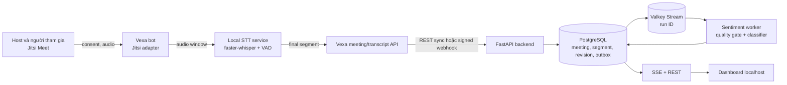

# Kiến trúc runtime Jitsi - Vexa - STT - Meeting Intelligence
> Trạng thái: kiến trúc runtime hiện hành cho demo/UAT cục bộ. Đây không phải
> kiến trúc production đã được benchmark về tải, độ chính xác ASR hoặc chất lượng
> sentiment.

## 1. Mục tiêu và phạm vi

Runtime hiện hành nhận URL phòng Jitsi dạng `https://meet.jit.si/<ten-phong>`.
Người chủ trì ở trong phòng, xác nhận consent, rồi Dashboard yêu cầu bot Vexa
tham gia. Jitsi là lớp hội nghị WebRTC; bot và pipeline ứng dụng không thay đổi
ngữ nghĩa dữ liệu của Jitsi.

Theo [kiến trúc chính thức của Jitsi Meet](https://jitsi.github.io/handbook/docs/architecture/),
Jitsi Meet dùng Jitsi Videobridge để định tuyến media, Jicofo để điều phối
phiên và Prosody cho signalling. Hệ thống này không tự triển khai lại các thành
phần đó; Jitsi chỉ là nguồn cuộc họp. Nếu tự host Jitsi, cần HTTPS hợp lệ cho
WebRTC và phải vận hành riêng domain/certificate/network theo
[hướng dẫn self-host chính thức](https://jitsi.github.io/handbook/docs/devops-guide/).

## 2. Sơ đồ luồng dữ liệu

Các đường trách nhiệm được tách như sau:

| Miền | Chủ sở hữu | Dữ liệu/trách nhiệm |
| --- | --- | --- |
| Jitsi | Nền tảng hội nghị | Phòng họp và media WebRTC; không là database phân tích của ứng dụng. |
| Vexa | Control plane bot/transcript | Vòng đời bot, capture và snapshot transcript. |
| STT local | Deployment transcription riêng | Giải mã audio thành segment; trả rỗng khi quality gate nguồn không đạt. |
| Meeting Intelligence | FastAPI, PostgreSQL, Valkey, worker, dashboard | Bản sao transcript, revision, phân tích, evidence và UI. |

PostgreSQL của ứng dụng là source of truth cho phân tích. Valkey chỉ vận chuyển
`run_id`; job có thể tạo lại từ `analysis_runs`, do đó không dùng queue làm nơi
lưu kết quả lâu dài.

## 3. Chất lượng transcript trước khi phân tích

STT local dùng `faster-whisper`, một triển khai Whisper trên CTranslate2. Tài
liệu dự án cho thấy thư viện hỗ trợ chạy CPU `int8`, language detection và VAD
có thể cấu hình; CTranslate2 được thiết kế cho decoding Transformer hiệu quả
trên CPU/GPU. Xem [faster-whisper](https://github.com/SYSTRAN/faster-whisper)
và bài báo [CTranslate2/OpenNMT](https://aclanthology.org/2020.ngt-1.25.pdf).

Trong runtime CPU hiện tại, worker dùng model `small`, `int8`, một request active
và VAD bảo thủ. Những quyết định này ưu tiên tính liên tục của cuộc họp trên CPU
hơn việc tuyên bố độ chính xác ASR. Chúng không tương đương tính năng khử ồn,
diarization hay dịch máy của một dịch vụ hội nghị thương mại.

Ba lớp bảo vệ được áp dụng trước khi sentiment:

1. **Tại STT:** bỏ audio/decoded result quá ngắn, candidate có tín hiệu confidence
   xấu, câu outro video/"subscribe" đã biết và không dùng prompt của window trước
   mặc định để tránh phản hồi lặp lỗi.
2. **Tại backend:** giữ raw segment để audit, nhưng gắn `analysis_eligible=false`
   cho segment rỗng, ngắn, không final, retracted, script không phù hợp hoặc khớp
   mẫu hallucination.
3. **Tại dashboard:** chỉ hiện mặc định segment đạt quality gate; người vận hành
   có thể bật dữ liệu bị lọc để đối chiếu. Segment bị lọc không đi vào KPI, timeline
   hoặc model.

Không có heuristic nào chứng minh transcript đúng. WER/CER chỉ được báo cáo khi
có audio, transcript chuẩn và quy tắc tokenization được chốt trước.

## 4. Routing ngôn ngữ và model

Dashboard gửi lựa chọn `vi`, `en` hoặc `auto` khi tạo bot. Router dựa trên nội
dung kết hợp metadata nguồn; text Việt-Anh trộn được ghi `mixed`. Baseline runtime
`baseline-rules-v3` hỗ trợ `vi` và `en`, nhưng trả `unknown` cho `mixed` hoặc ngôn
ngữ không hỗ trợ. Đây là baseline theo luật để kiểm chứng contract, không phải
mô hình đã huấn luyện hoặc một dịch vụ dịch thuật.

Model artifact `tfidf-logreg` chỉ được kích hoạt khi operator cung cấp thư mục
mount read-only cùng SHA-256 đã xác minh. PhoBERT hoặc model khác chỉ được đưa
vào sau khi có corpus phù hợp, model card, split độc lập theo meeting và đánh
giá tái lập được.

## 5. Vận hành và giới hạn

- Vào phòng Jitsi trước khi yêu cầu bot; không cần luồng "Admit" kiểu guest của
  Google Meet, nhưng quyền của phòng Jitsi vẫn do host quản lý.
- Chỉ chạy test thực khi người tham gia đã được thông báo/đồng ý; không commit
  transcript, token, cookie, audio hay secret.
- Dashboard bind loopback trong development. Production cần TLS, authentication,
  authorization, retention/delete, backup/restore và giám sát queue/latency.
- Vexa cung cấp bot/transcript API và có hướng dẫn self-host/capture riêng; xem
  [Vexa Quickstart](https://docs.vexa.ai/quickstart). Mã ứng dụng không đưa API
  key Vexa vào browser.
- Kết quả sentiment mô tả text đủ điều kiện trong một analysis unit; không dùng
  để chẩn đoán, chấm điểm hay ra quyết định về một cá nhân.

## 6. Kiểm chứng tối thiểu

1. Chạy test backend và transcription service.
2. Build/recreate `backend`, `worker`, `dashboard` và transcription worker.
3. Kiểm `GET /ready`, `GET /health` của STT và tải Dashboard.
4. Tạo phòng Jitsi có consent, xác nhận bot vào phòng, nói thử câu Việt/Anh rõ
   ràng, rồi kiểm segment final, quality reason, run/revision và evidence.
5. Lưu evidence đã redaction: commit/image digest, thời gian, command, exit code
   và trạng thái service; không lưu raw transcript.
