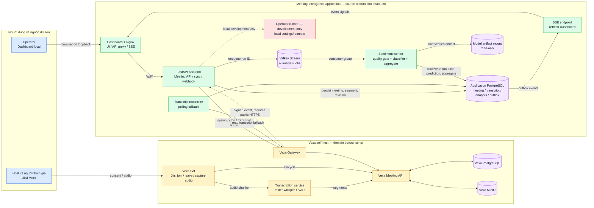
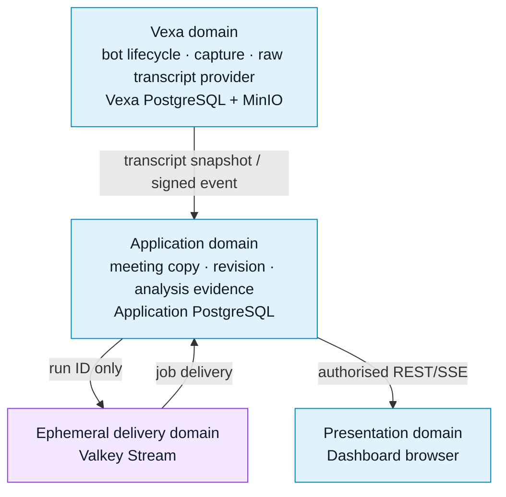

# Kiến trúc và các module — Meeting Intelligence

> Phiên bản kiến trúc: MVP hiện tại
> Phạm vi: Jitsi Meet retrospective, chỉ phân tích sắc thái transcript sau cuộc họp.
> Không dùng output để đánh giá con người, nhân sự, học tập hoặc sức khoẻ tâm thần.

## 1. Architecture diagram

### Cách đọc sơ đồ

1. Vexa chịu trách nhiệm đưa bot vào Jitsi Meet và tạo transcript. Jitsi là lớp hội nghị WebRTC; bot không thay thế các thành phần JVB/Jicofo/Prosody của Jitsi.
2. Application **không coi Vexa là source of truth cho analytics**: transcript/revision được sao chép vào Application PostgreSQL.
3. FastAPI tạo analysis run bền vững; Valkey chỉ chuyển job sang worker, không phải nơi lưu kết quả chính.
4. Worker xử lý quality gate, classifier và aggregate; Dashboard đọc kết quả qua REST/SSE.
5. `operator-runner` chỉ được phép tồn tại ở local development; tuyệt đối không đưa thành phần mount Docker socket ra production.

## 2. Danh mục module

| Module | Thành phần chính | Trách nhiệm | Input | Output | Trạng thái/ràng buộc |
| --- | --- | --- | --- | --- | --- |
| Meeting UI | `src/dashboard` | Tạo meeting, xem transcript, timeline, evidence, trạng thái model | User action, REST/SSE | UI Dashboard | Local loopback; không là nơi giữ secret. |
| API gateway nội bộ | Nginx Dashboard | Phục vụ static UI, proxy `/api/*` tới backend | Browser request | Backend request/response | Cần TLS/auth phía reverse proxy khi production. |
| Meeting lifecycle | `app/main.py`, `app/vexa.py` | Validate URL Jitsi, spawn/stop bot, ownership check | URL, user identity | Application meeting UUID, trạng thái bot | Auth hiện chỉ là development header; chưa production-ready. |
| Transcript reconciler | `app/service.py`, poller trong `app/main.py` | Đọc transcript từ Vexa, upsert segment, tăng revision, phát outbox | Vexa transcript snapshot | `transcript_segments`, outbox event | Cần bổ sung xử lý retraction và timestamp absolute/relative. |
| Webhook receiver | `/v1/webhooks/vexa` | Xác minh HMAC/timestamp, dedupe event, trigger finalize | Vexa signed event | `incoming_webhooks`, final analysis run | Cần public HTTPS URL; hiện runtime chưa cấu hình URL webhook. |
| Application database | PostgreSQL application | Source of truth: meeting, transcript, run, unit, prediction, aggregate, outbox | API/worker writes | Dữ liệu audit và Dashboard query | Cần retention/delete, backup/restore drill. |
| Analysis orchestration | `api/analytics.py`, `repositories/analysis.py` | Tạo run idempotent theo meeting/revision/model, enqueue job | Meeting revision, model config | `analysis_runs`, Valkey message | Cần retry/requeue khi run failed. |
| Queue | Valkey Stream | Truyền `run_id` từ API sang worker | Analysis job | Consumer message | Không phải source of truth; `XAUTOCLAIM` reclaim pending message sau idle lease, vẫn cần monitor lag. |
| Sentiment worker | `workers/sentiment.py` | Build unit, quality-gate, predict, aggregate, phát outbox | Job + transcript final | Unit, prediction, windows, metrics | Cần healthcheck riêng và retry policy hoàn chỉnh. |
| Quality gate | `analysis/quality.py`, `analysis/units.py` | Chuẩn hoá text, lọc segment ngắn/noise/hallucination, gộp unit | Transcript segment final | Accepted/rejected analysis unit | Chỉ là hygiene rule, không chứng minh model accuracy. |
| Classifier adapter | `analysis/classifier.py` | Chạy `rules` hoặc TF-IDF Logistic Regression artifact đã hash | Analysis unit tiếng Việt | Label, confidence, probabilities | `rules` là baseline, không dùng để claim chất lượng nghiệp vụ. |
| Realtime refresh | SSE `/events` + outbox | Báo Dashboard tải lại dữ liệu khi transcript/analysis đổi | Outbox event | SSE event signal | Resume theo `Last-Event-ID`; vẫn cần retention/scale design trước production. |
| Vexa control plane | Vexa Gateway, Meeting API, DB, MinIO | Bot lifecycle, transcript provider, object/control-plane data | Jitsi Meet/STT local | Transcript snapshot, lifecycle event | API parser còn tương thích Google Meet lịch sử; backup domain độc lập với application DB. |
| Transcription | STT service | Biến audio thành transcript segment; source gate bỏ result ngắn/noise/media-outro | Audio capture | Text, time, language, speaker metadata | CPU `small`/INT8 ưu tiên continuity; không claim WER hoặc dịch máy. |
| Operator configuration | `operator-runner` | Cập nhật allow-list settings và recreate service local | Local operator config | Runtime config mới | **Development only**; không chạy ở production. |

## 3. Dữ liệu và ranh giới trách nhiệm

| Dữ liệu | Chủ sở hữu | Quy tắc bắt buộc |
| --- | --- | --- |
| Audio/transcript nguồn, bot lifecycle | Vexa | Bảo vệ API key; backup Vexa DB và MinIO riêng. |
| Bản sao transcript, revision, evidence, prediction | Meeting Intelligence | Consent, RBAC, retention/delete, encryption/backup/restore. |
| Analysis job đang chờ | Valkey | Có thể tái tạo từ `analysis_runs`; cần monitor/reclaim, không dùng làm database chính. |
| Dashboard state | Browser | Không chứa API key, password hay raw secret; chỉ truy cập qua identity đã xác minh. |

## 4. Luồng xử lý chuẩn

1. Operator có consent tạo meeting Jitsi; backend gọi Vexa để spawn bot.
2. Host đang ở phòng Jitsi; bot capture audio và gọi STT.
3. Vexa tạo transcript snapshot/event; backend webhook hoặc poller đồng bộ vào Application PostgreSQL.
4. Backend tăng `transcript_revision`, tạo `analysis_run` và gửi `run_id` vào Valkey.
5. Worker xây analysis unit, áp quality gate, gọi classifier, lưu prediction/aggregate/metrics vào PostgreSQL.
6. Outbox event làm Dashboard refresh qua SSE; operator xem evidence gắn với run, model version và transcript revision.

## 5. Module cần ưu tiên trước pilot thật

| Ưu tiên | Module | Việc phải hoàn thành |
| --- | --- | --- |
| P0 | Transcription + Vexa integration | Theo dõi STT source gate, chạy E2E Jitsi có consent theo protocol và giữ evidence đã redaction. |
| P0 | Transcript reconciler | Xử lý retraction và absolute/relative timestamp; thêm contract test. |
| P0 | Identity/authorization | JWT/session, workspace-role, tenant isolation test. |
| P1 | Queue + worker | Retry policy, heartbeat/healthcheck và queue lag alert; pending reclaim đã có nhưng cần forced-restart evidence. |
| P1 | Data lifecycle | Retention, delete workflow, backup/restore drill. |
| P1 | Model | Corpus meeting đã consent + benchmark hợp lệ trước khi diễn giải sentiment. |
| P2 | Dashboard/SSE | Outbox retention và scale/load test; resume cursor đã có. |
| P2 | Operator runner | Tách dev-only compose, loại Docker socket khỏi production. |

## 6. Quy tắc kiến trúc không được vi phạm

- PostgreSQL application là source of truth cho analysis; Valkey chỉ là queue/fan-out.
- Không đặt Vexa API key, password hoặc Docker socket vào Dashboard/browser.
- Không dùng output model để đánh giá cá nhân.
- Không đưa transcript thật, consent form hoặc raw evidence vào Git/CI/log.
- Không triển khai public trước khi có auth thật, TLS, retention/delete và backup/restore được kiểm chứng.
